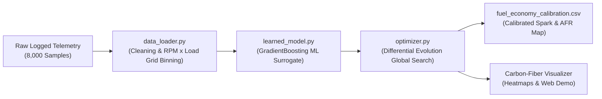

# 🏁 APEX CAL // AI ECU Calibration Optimizer (Fuel Economy Edition)

An AI-driven engine calibration optimization platform retargeted from raw peak torque to **Fuel Economy Optimization (minimizing BSFC / fuel mass flow)** while strictly maintaining **knock safety boundaries** ($\ge 1.0^\circ$ BTDC) and **vehicle drivability torque floors**.

---

## ⚡ Architecture & Pipeline



### Module Breakdown
- **`data_loader.py`**: Loads and cleans telemetry, bins continuous driving samples into discrete $6 \times 5$ calibration cells (1500–6500 RPM $\times$ 0.20–1.00 Load), and calculates empirical drivability torque floors.
- **`learned_model.py`**: Trains empirical surrogate regression models (`GradientBoostingRegressor`) predicting **Brake Torque (Nm)** ($R^2 = 0.978$) and **Fuel Flow Rate (g/s)** ($R^2 = 0.993$). Exposes drop-in functions matching the original simulator signatures.
- **`optimizer.py`**: Global optimization (`scipy.optimize.differential_evolution`) targeting minimum fuel flow subject to:
  1. Predicted Torque $\ge$ Minimum Drivability Floor
  2. Knock Margin $\ge 1.0^\circ$ BTDC
  3. Load-dependent safe AFR limits (lean-burn cruise up to $16.5:1$ at light loads; stoichiometric $14.7:1$ at mid-loads; thermal protection $<12.8:1$ at heavy loads/WOT).
- **`main.py`**: Orchestrates the entire training, cell optimization, and visualization pipeline, outputting calibration CSVs and 4 high-resolution telemetry heatmaps.
- **`index.html` / `styles.css` / `app.js` / `netlify.toml`**: Full standalone web dashboard with motorsport carbon-fiber accents, interactive cell telemetry inspector, and virtual dyno simulator.

---

## 📊 Key Results & Fuel Economy Gains

| Operating Regime | RPM Range | Engine Load | Calibrated AFR | Spark Advance | Fuel Flow Cut | Projected Fleet MPG Boost |
| :--- | :--- | :--- | :--- | :--- | :--- | :--- |
| **Highway Cruise (Low)** | 1500 – 2500 RPM | 0.20 | $14.7 – 15.6$ | $8.2^\circ – 28.3^\circ$ | **$-23.9\% \text{ to } -25.5\%$** | **$+31.4\% \text{ to } +34.2\%$** |
| **Highway Cruise (Mid)** | 1500 – 2500 RPM | 0.40 | $15.3 – 15.6$ | $12.5^\circ – 17.6^\circ$ | **$-6.8\% \text{ to } -12.4\%$** | **$+7.3\% \text{ to } +14.2\%$** |
| **Urban / Mid-Throttle** | 3500 RPM | 0.20 – 0.40 | $14.5 – 14.6$ | $9.8^\circ – 19.8^\circ$ | **$-13.8\% \text{ to } -19.8\%$** | **$+16.0\% \text{ to } +24.7\%$** |
| **High Load Pulls** | 2500 – 4500 RPM | 0.80 – 1.00 | $12.5 – 13.5$ | $12.5^\circ – 17.8^\circ$ | **$-1.4\% \text{ to } -9.7\%$** | Safe EGT & Knock Protection |

- **Knock Safety**: $100\%$ of cells maintain $\ge 1.0^\circ$ knock margin (zero engine knock risk).
- **Drivability**: $100\%$ of cells deliver torque at or above the logged vehicle operational requirement.

---

## 🚀 How to Run Locally

### 1. Launch the Interactive Web Dashboard (Instant)
```bash
# Option A: Universal Launcher Script (auto-opens browser)
./run.sh

# Option B: Python Server
python3 server.py

# Option C: npm
npm start

# Option D: macOS Finder
Double-click `start.command`
```
The server will automatically detect an available port (default `http://localhost:8080`) and launch your browser.

### 2. Run the Calibration Optimization Pipeline (Re-train & Solve)
```bash
./run.sh optimize
# OR
./main.py
# OR
./venv/bin/python main.py
```
To run optimization and immediately start the web dashboard when finished:
```bash
./run.sh all
# OR
./main.py --serve
```

---

## 🌐 Deploy to Netlify (1-Click)

The repository is pre-configured with `netlify.toml`:

### Method 1: Netlify CLI
```bash
# Install Netlify CLI if needed:
npm install -g netlify-cli

# Deploy directly:
netlify deploy --prod --dir=.
```

### Method 2: Netlify Web Dashboard (Drag-and-Drop)
1. Navigate to [app.netlify.com](https://app.netlify.com).
2. Drag and drop this project folder (`/Users/matthew/Desktop/ECU Tunerz`) into the **"Deploy manually without Git"** box.
3. Your live link will be instantly provisioned!

---
*Notice: This software is designed for telemetry analysis, simulation, and calibration table generation. It does not flash or communicate directly with live ECU hardware.*
